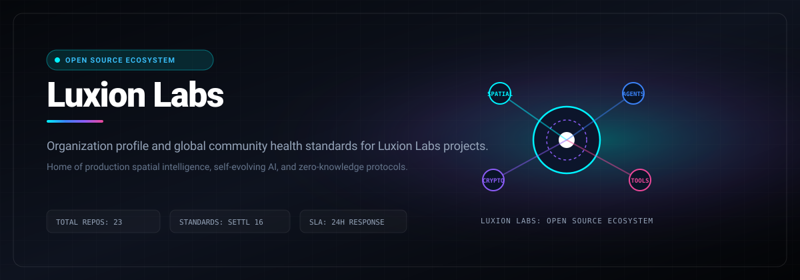

# Luxion Labs

> Organization profile and global community health standards for Luxion Labs open-source projects.

  
  &nbsp;
  
  &nbsp;
  
  &nbsp;
  

  
  &nbsp;
  
  &nbsp;
  

---

## Welcome to Luxion Labs

Luxion Labs is an engineering studio dedicated to building high-velocity, production-grade open source software across spatial AI, autonomous agents, and cryptography.

### Repository Index

| Repository | Category | Description | Live Preview |
|------------|----------|-------------|--------------|
| **Vybe** | Microservices | Resilient URL shortener with distributed metrics, tracing, and runbooks | [vybe.luxionlabs.com](https://vybe.luxionlabs.com) |
| **Blink Speech** | Assistive Tech | Browser assistive app converting eye blink patterns into voice | [blink-speech.vercel.app](https://blink-speech.vercel.app) |
| **Stun** | Spatial AI | Infinite spatial canvas where Gemini AI navigates and organizes thoughts | [stun.luxionlabs.com](https://stun.luxionlabs.com) |
| **SafeMap** | Geospatial Safety | Anonymous community safety platform with real-time risk maps | [safemap-evorozon.vercel.app](https://safemap-evorozon.vercel.app) |
| **Cheaters Dilemma** | Game Theory | Multi-agent simulation modeling strategic defection in token economies | [cheaters-dilemma.vercel.app](https://cheaters-dilemma.vercel.app) |
| **AXON** | Self-Evolving AI | Autonomous AI platform generating verified skill modules at runtime | [axon.luxionlabs.com](https://axon.luxionlabs.com) |
| **EIDO** | Autonomous Foundry | AI agent discovering problems, building MVPs, and tokenizing on Base | [eido-lyart.vercel.app](https://eido-lyart.vercel.app) |
| **ORIN** | Context OS | Context operating system powered by Notion MCP and Gemini AI | [orin-delta.vercel.app](https://orin-delta.vercel.app) |
| **Rios** | Spatial Computing | Interactive spatial intelligence combining 2D web maps with 3D | [rios.luxionlabs.com](https://www.rios.luxionlabs.com) |
| **EntangleMe** | Quantum | Quantum teleportation messaging app simulating qubit transfer with Qiskit | [luxion-labs.github.io/EntangleMe](https://luxion-labs.github.io/EntangleMe/) |
| **Prismarine** | API Testing | Fast, local-first API debugging workbench built with Bun | [prism.luxionlabs.com](https://prism.luxionlabs.com) |
| **Maple** | Native Audio | Lightweight, ad-free YouTube Music client written in Rust & Tauri 2.0 | [maple.luxionlabs.com](https://maple.luxionlabs.com) |
| **Animix** | 2D Sprites | 2D sprite animation and spritesheet generation workbench | [animix.luxionlabs.com](https://animix.luxionlabs.com) |
| **REAP** | ZK Protocol | Zero-knowledge asset distribution protocol on Midnight Network | [reap-eight.vercel.app](https://reap-eight.vercel.app) |
| **Pulm Notes** | Local-First | Privacy-focused personal note-taking desktop and web app | [pulm.luxionlabs.com](https://pulm.luxionlabs.com) |
| **ProdForge** | Backend Blueprint | Production backend kit with Flask, PostgreSQL, Redis, Prometheus | [prodforge.luxionlabs.com](https://prodforge.luxionlabs.com) |
| **Zera** | ZK Marketplace | Institutional zero-knowledge digital asset marketplace on Midnight | [zera.luxionlabs.com](https://zera.luxionlabs.com) |

---

## Maintainer Response SLA
Luxion Labs enforces a strict 24-hour response SLA on all community issues, feature proposals, and pull requests. See [CONTRIBUTING.md](CONTRIBUTING.md) for full development guidelines.

## License
Distributed under the MIT License. See [LICENSE](LICENSE) for details.
